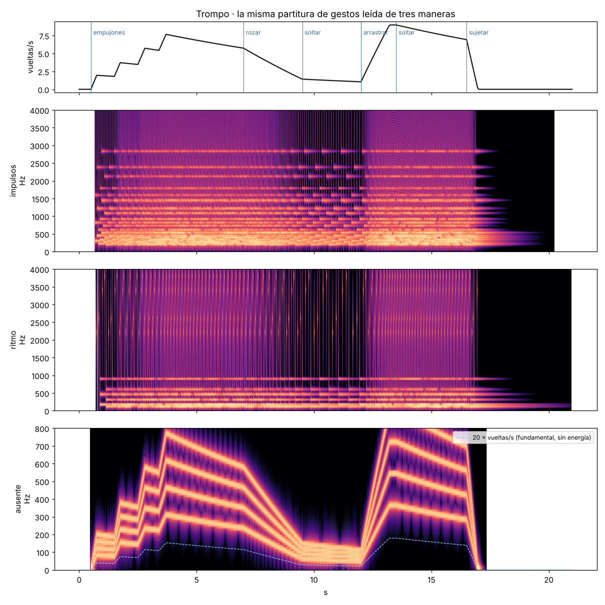

# Trompo

Canek Zapata · 23 de octubre de 2026 · versión 0.1.0 (`trompo-0.1.0`). Título provisional.

> Todos los colores están, en efecto, aquí.
> — *El disco de Newton*

Un disco con un patrón escrito: marcas, cada una con su sonido y su color. Se
acelera hasta que sus partes dejan de distinguirse. Después se frena con la mano
y se recupera el acceso a ellas. **Frenar devuelve la diferencia que el giro te
impedía distinguir.** La pieza pregunta cuánto de lo que creemos perdido
simplemente dejó de ser legible.

La concepción de la pieza es de Canek, a partir de la conversación del 23 de
octubre:

- El centro es el acto de frenar, no la fusión.
- El patrón se conserva siempre.
- No hay destino programado («blanco», ruido u oscilador que aparezca al cruzar
  una cifra).
- La lectura de impulsos y la fundamental ausente son dos procedimientos
  separados.
- Imagen y sonido comparten un mismo giro, y sus respuestas perceptivas pueden
  divergir.

## Abrir

```sh
python3 -m http.server 8765 --directory instrumentos/trompo
# http://127.0.0.1:8765/
```

Necesita un navegador con AudioWorklet y módulos ES. No usa bibliotecas, red ni
pasos de compilación. El audio empieza después de un gesto.

## Tocar

| Gesto | Qué hace en el motor |
|---|---|
| Arrastrar el disco | La mano roza el disco e intenta igualar su velocidad: lo impulsa |
| Soltar | El disco sigue por inercia; el eje lo frena despacio |
| Mantener apretado sin mover | La mano quieta frena hasta detenerlo; nunca lo invierte |
| Mayúsculas al apretar | Rozar: la misma mano con poca presión |
| Flechas ← → | Empujar con un torque constante |
| Espacio (Mayús + Espacio) | Frenar (rozar) |
| Doble clic en el borde, con el disco detenido | Añadir o quitar una marca, en una rejilla de 1/48 de vuelta |

Sólo se puede reescribir el patrón con el disco detenido: **sólo se reescribe lo
que se alcanza a distinguir**.

## El cuerpo: acelerar y frenar no son simétricos

```text
I · dω/dt = empuje + mano − b·ω − μ·sign(ω)
mano = clamp(c · (ω_mano − ω), ±presión · τ_max)
```

- **I (peso).** Un disco pesado exige gestos largos: la duración del gesto
  construye la forma.
- **b (eje viscoso).** Caída exponencial; el disco nunca se detiene sólo con
  esto.
- **μ (eje seco).** Caída lineal y parada en tiempo finito, `t = I·ω₀/μ`.
- **La mano** es rozamiento con un límite. Si la mano va más rápido que el
  disco, lo arrastra; si va más lento o está quieta, lo frena. Si la mano y el
  disco van casi a la misma velocidad, la mano se pega a él. Si la diferencia es
  grande, la mano patina, y entonces su efecto es el de un rozamiento seco.
- **Acelerar** se hace a empujones o arrastrando; **frenar** es rozamiento
  continuo. Las mismas velocidades se recorren con curvas distintas, y el tiempo
  que se pasa en cada zona cambia.

El rozamiento seco nunca invierte el giro: si en un paso fuera a cruzar cero, el
disco se detiene.

## Tres tasas, siempre declaradas

Con N marcas y r vueltas por segundo, la página muestra:

- **vueltas/s (r):** cada cuánto vuelve el disco a la misma posición.
- **eventos/s (N·r):** densidad de golpes, si las marcas están equiespaciadas.
- **motivo/s (r):** con marcas distintas, el motivo completo se repite una vez
  por vuelta.

Con 8 marcas a 5 vueltas/s hay 40 eventos/s, pero el motivo se repite 5 veces
por segundo. **No se asigna una altura a ninguna de esas cifras**: qué se oye a
cada velocidad se comprueba escuchando.

## Dos procedimientos auditivos, separados

1. **Impulsos.** Cada marca que cruza la lectura fija (el triángulo) excita su
   propio resonador, una barra golpeada de tres modos o un clic. El sentido de
   giro no cambia el sonido. Los resonadores siguen sonando entre golpes. A
   velocidad alta, la superposición de los ocho produce un acorde sostenido con
   su rugosidad, no ruido blanco (ver el espectrograma).
2. **Fundamental ausente.** El disco lleva una pista óptica:
   `s = Σ sen(2π·h·D·θ)` con h = 2, 3, 4 y 5, y D = 20 ciclos por vuelta. A r
   vueltas/s hay componentes en 2Dr…5Dr y **ninguna en Dr**, aunque la señal es
   periódica en 1/(Dr). Es la condición que propuso Canek (200–500 Hz sin
   100 Hz, a 5 vueltas/s). La FFT describe la señal; lo que alguien oye se
   comprueba con emparejamiento de altura.

Barajar voces es una **condición de control**, no parte de la obra. Las voces
se permutan en cada vuelta con una semilla, de modo que la densidad se conserva
y el periodo del motivo se rompe.

## La imagen

El sonido corre en un AudioWorklet y no depende del cuadro de la pantalla. La
imagen sólo lee el ángulo que informa el worklet.

- **Exposición por cuadro (por omisión).** Cada cuña de la pantalla muestra el
  color medio, en luz lineal, del material que pasó por ella durante el cuadro.
  La media es exacta, por arcos, y para la pista óptica es una integral cerrada.
  Imita una cámara con obturador abierto todo el cuadro. **No es la percepción.**
  A una velocidad dada, la mancha depende de la frecuencia de refresco del
  monitor, no del ojo.
- **Instante.** El disco en un solo momento por cuadro. Por encima de unas
  marcas×vueltas ≈ 30 por segundo aparece el efecto de la rueda de carreta: el
  disco parece ir más lento o al revés. **Ese efecto lo produce el monitor.**

Los ocho colores tienen la misma luminancia en OKLCH (L = 0.72, C = 0.11), y sus
nombres vienen del texto: amarillo, cañaveral, aguamarina, azul, violeta, rosa,
rojo, naranja. Igualar la luminancia reduce el riesgo de destellos, pero no lo
elimina. La pantalla de inicio avisa.

## Tomas reproducibles

**Grabar toma** guarda un JSON con el estado completo inicial del motor (ángulo,
velocidad, resonadores, filtros) y cada gesto, anotado con el bloque de 128
muestras en que se aplicó. `node renderizar.mjs toma.json toma.wav` la vuelve a
calcular muestra por muestra. También hay partituras de gestos:
`node renderizar.mjs demo:impulsos salida.wav` (y `demo:ausente`, `demo:ritmo`).

## Muestras

Las tres usan la misma partitura de gestos (21 s):

- 4 empujones hasta unas 7,7 vueltas/s.
- Giro libre.
- Rozar desde 7 s.
- Soltar a 9,5 s.
- Arrastrar desde 12 s.
- Soltar.
- Sujetar desde 16,5 s, hasta detener el disco.

| Muestra | Patrón | Nivel | Huella del WAV |
|---|---|---|---|
| [impulsos](muestras/trompo-impulsos-997c5244a533.m4a) | ocho colores | −19,2 LUFS · −4,7 dBTP | `997c5244a533` |
| [ritmo](muestras/trompo-ritmo-ece574cffbe2.m4a) | 6 marcas irregulares, clics y tonos | −23,8 LUFS · −8,8 dBTP | `ece574cffbe2` |
| [fundamental ausente](muestras/trompo-ausente-ff3497dd4c37.m4a) | pista de 20 ciclos, armónicos 2–5 | −16,2 LUFS · −6,9 dBTP | `ff3497dd4c37` |

Las huellas son del WAV PCM16 que escribe `renderizar.mjs`; los M4A son copias
para escuchar. Los niveles son los de salida, sin normalizar. El limitador no se
activó en ninguna.



Arriba, la velocidad del disco. En *ausente*, la línea punteada marca dónde
estaría la fundamental: el espectrograma no tiene energía ahí.

## Qué se comprobó

`node pruebas.mjs`: 19 pruebas, todas pasan.

- **Física:**
  - El rozamiento viscoso da una caída exponencial.
  - El rozamiento seco detiene el disco a los 16 s exactos y no lo invierte.
  - La mano quieta frena sin invertir.
- **Eventos:**
  - Conteo exacto (400 eventos en 10 s, en ambos sentidos).
  - Misma densidad con 8 marcas a 5 v/s y con 4 marcas a 10 v/s.
- **Fundamental ausente:**
  - 100 Hz está 167 dB por debajo de 200 Hz.
  - La autocorrelación tiene su máximo en 10,00 ms.
- **Barajar:** conserva la densidad, cambia el orden por vuelta y es
  reproducible.
- **Tomas:**
  - Huella idéntica en dos renders.
  - Señal finita y sin limitador.
  - Retomar desde una instantánea a mitad de la toma da cada muestra igual.
- **Patrón:** girar y frenar no lo cambia.
- **Imagen:** la integración de exposición da medias por arco correctas.

En Chromium sin pantalla (Playwright) se probaron:

- Arrastre, freno con la mano quieta, teclado, cambio a fundamental ausente,
  imagen «instante» y vista de 390 px.
- Sin errores en la consola.
- Se miraron las capturas.

## Qué no se comprobó

- **Escucha humana.** El agente no escuchó ninguna muestra. Todo lo de arriba
  describe la señal.
- **Histéresis.** Es una hipótesis: que la misma velocidad se oiga distinta según
  se llegue acelerando o frenando, por analogía con las fronteras de agrupamiento
  de van Noorden (1975, con tonos alternados, no con este estímulo; citado de
  memoria, falta verificarlo). La prueba propuesta es recorrer la misma rampa
  hacia arriba y hacia abajo y anotar dónde cambia la escucha en cada sentido.
  El motor es simétrico; no hay ningún umbral programado.
- **Comparaciones pendientes de escucha** (las que propuso Canek):
  - Mismo número de eventos/s con distinto número de sectores.
  - Regularidad contra irregularidad con igual densidad media.
  - Fundamental ausente con emparejamiento de altura.
- **Fuentes que citó Canek y que no se abrieron en esta sesión:** Ungan y
  Yagcioglu (2014), Tanabe et al. (2011), Cedolin y Delgutte (2005) y el estudio
  sobre Talbot–Plateau.
- **Pruebas que faltan:** teléfono físico, pantallas de 120 Hz y doble toque
  para editar en pantallas táctiles.
- **Edición pendiente:** desde la página todavía no se pueden cambiar las
  duraciones ni el tipo de cada marca; sólo añadir y quitar marcas. Separaciones
  y duraciones libres son el siguiente paso.

## Archivos

| Archivo | Qué es |
|---|---|
| `motor.mjs` | Física, patrón, voces y pista; sin DOM ni Web Audio |
| `worklet.mjs` | AudioWorklet: aplica gestos en bordes de bloque y graba tomas |
| `interfaz.mjs`, `index.html` | Disco, mano, recorrido e integración de exposición |
| `renderizar.mjs` | Tomas y partituras de gestos → WAV + traza de velocidad |
| `pruebas.mjs` | Las 19 pruebas |
| `muestras/` | M4A de las tres demos y su espectrograma |
